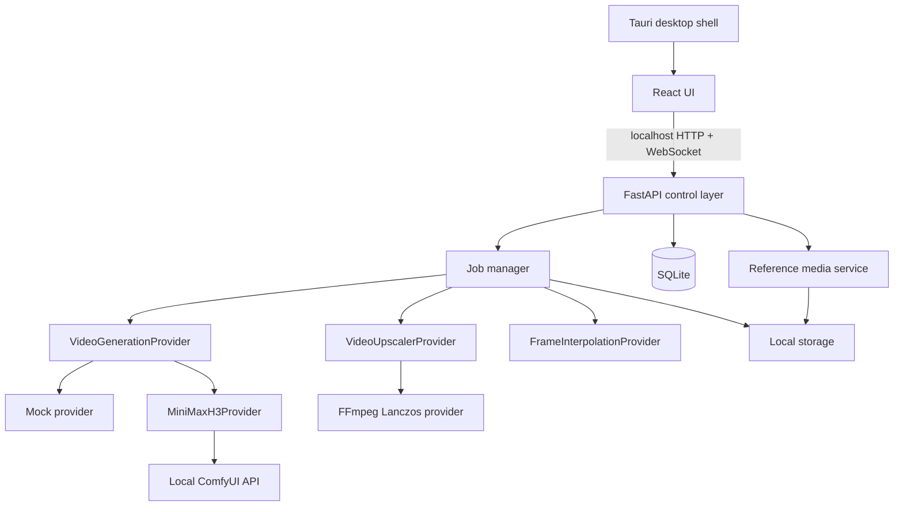

# Architecture

## Goals

H3 Local Studio separates creative UI, orchestration, inference, media processing, and persistence. The core must continue to work on one Windows workstation without an internet connection after runtimes and models are installed.

## Runtime boundaries



- Tauri owns the desktop window. It has no broad filesystem or shell permission.
- React owns display and human-friendly input. It has no model-specific code or ComfyUI graph IDs.
- FastAPI validates requests and local paths, exposes status, and coordinates jobs.
- The job manager serializes GPU-heavy work, persists every transition, and publishes live progress.
- Providers isolate replaceable generation, upscale, and interpolation implementations.
- SQLite stores metadata and paths, never media binaries.

## Repository layout

```text
backend/app/
├── api/             HTTP and WebSocket routes
├── jobs/            queue, progress broker, state transitions
├── migrations/      ordered SQLite migrations
├── models/          Pydantic API/domain contracts
├── providers/       ComfyUI, mock, FFmpeg, and provider interfaces
├── repositories/    SQLite access
└── services/        hardware, media, paths, workflow graphs

src/
├── components/      shared visual components and result UI
├── hooks/           WebSocket progress with polling fallback
├── pages/           product-level screens
├── services/        typed local API client
└── types/           frontend contracts
```

## Job lifecycle

Allowed terminal-safe transitions are:

```text
queued → preparing → running → post-processing → completed
   └───────────────→ cancelled
   └───────────────→ failed
```

The default queue has one worker. This matches a single RTX 5070 Ti and prevents concurrent H3 checkpoints from competing for 16 GB of VRAM. Lightweight CPU work can later move to a separate executor.

On startup, incomplete jobs from a previous process are marked failed with a recoverable explanation. Completed intermediates remain on disk.

## Storage and reproducibility

Each output has a UUID and a date/project directory. Original and resized variants never share a filename. `metadata.json` is written beside output media so generations remain portable even if the SQLite database is migrated later.

SQLite uses migration files and WAL mode. Current schema includes projects, generations, generation files, reusable media assets, project-to-asset membership, immutable generation reference snapshots, saved prompts, workflows, workflow runs, settings, and jobs. Reference binaries live once in content-addressed storage; project reuse and generation provenance point to the same asset ID rather than copying large source clips.

## Security model

- API and ComfyUI defaults are restricted to loopback addresses.
- CORS allows only the local Vite origin and known Tauri origins.
- Media routes use generation IDs, not arbitrary paths from the frontend.
- Resolved media paths must remain under the configured data root.
- External commands are fixed argument arrays; prompt text is never interpolated into shell commands.
- Tauri exposes only `core:default` in Phase 1.
- Cloud storage, authentication, analytics, and public ports are absent.

## Future remote mode

A later authenticated transport could sit in front of the FastAPI boundary, including a user-managed Cloudflare Tunnel. No provider, repository, or UI-to-model boundary needs to change. Public binding and tunnel provisioning are intentionally absent from the MVP.
